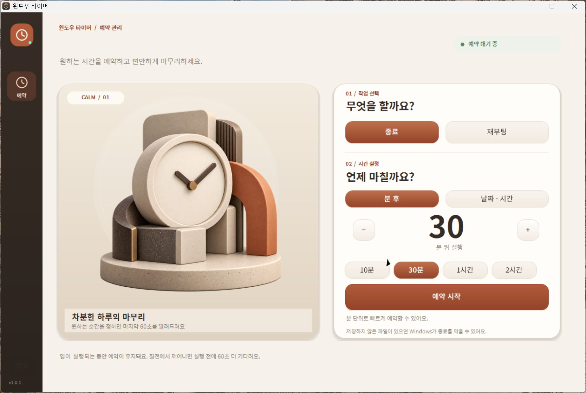

<div align="center">

# 윈도우 타이머 · WindowsTimer

[](#)
[](https://github.com/cybereun/windows-timer/releases)
[](https://github.com/cybereun)

[한국어](#한국어) · [English](#english) · [日本語](#日本語) · [简体中文](#简体中文)

[릴리스 기록 · Release history · 更新履歴 · 更新记录](CHANGELOG.md)



</div>

## 한국어

윈도우 타이머는 Windows 종료, 재부팅, 절전, 최대 절전을 예약하는 가벼운 Windows 데스크톱 앱입니다. 기존 메인 예약 화면은 유지하고, **고급** 메뉴의 일정·보호·시스템·프로필·기록·원격 설정을 네 개 탭으로 나눴습니다. 한 번에 한 종류의 설정만 표시합니다. Google Fonts의 Noto Sans KR 글꼴과 앱 아이콘을 실행 파일에 포함해 별도 설치 없이 실행할 수 있습니다.

### 기능

- 분 단위 또는 날짜·시간으로 예약하고 실행 60초 전에 알림을 표시합니다. 예약은 언제든 취소하거나 10분 연장할 수 있습니다.
- 매일 또는 선택한 요일마다 반복 예약을 실행합니다.
- 메인 화면의 빠른 시간 버튼 4개를 원하는 분 값으로 바꿉니다.
- 배터리 잔량, AC 전원 연결, 키보드·마우스 유휴 조건을 설정합니다. 조건이 맞지 않으면 5분씩 보류하고 정한 제한 시간 후 예약을 취소합니다.
- 예약 기록과 종료 방식·시간 프로필을 저장합니다.
- Windows 로그인 시 자동 실행, 절전 타이머로 PC 깨우기, 시스템 트레이 남은 시간 표시를 설정합니다.
- 한국어, 영어, 일본어, 중국어 간체 UI를 제공합니다.
- 휴대폰이나 다른 PC의 브라우저에서 현재 PC의 예약을 만들고 취소합니다. 같은 네트워크에서는 LAN 주소를 쓰고, 5G에서는 **5G 인터넷 연결 시작**을 눌러 임시 HTTPS 주소를 만듭니다. 앱에 표시되는 QR을 스캔하면 주소와 5분 유효 연결 코드가 자동 적용되어 직접 입력할 필요가 없습니다. Cloudflare 터널 프로그램은 요청 시 공식 배포처에서 내려받고 SHA-256을 확인합니다.
- 앱 시작 후 12초 뒤 최신 버전을 확인하고, 새 버전이 있으면 GitHub CLI로 자동 다운로드·검증·교체·재실행합니다. 예약 실행 중에는 예약이 끝난 뒤 적용합니다. 비공개 저장소 접근을 위해 `winget install --id GitHub.cli`로 GitHub CLI를 설치하고 `gh auth login --hostname github.com`으로 한 번 로그인해야 합니다. v1.1.3에서 업데이트 연결 오류를 수정했습니다. v1.1.2 사용자는 v1.1.3을 한 번 직접 설치해야 하며, 이후 버전부터 자동 업데이트됩니다.

### 다운로드와 실행

1. [Releases](https://github.com/cybereun/windows-timer/releases)에서 `WindowsTimer-v1.1.5.exe` 또는 배포 ZIP을 받습니다. 저장소가 비공개이므로 접근 권한이 있는 GitHub 계정으로 로그인해야 합니다.
2. 실행 파일을 열고 메인 화면에서 종료·재부팅과 시간을 선택한 뒤 **예약 시작**을 누릅니다.
3. 예약 중에는 앱을 실행해 두세요. 창을 닫으면 시스템 트레이로 숨겨지고, 트레이의 **앱 종료**는 예약도 취소합니다. 저장하지 않은 파일은 미리 저장하세요.

절전·최대 절전은 **고급 → 한 번 예약 · 다른 동작**에서 설정합니다. 반복 일정과 보호 조건도 고급 화면에서 따로 저장할 수 있습니다. 설정과 예약 기록은 현재 Windows 사용자 프로필 아래 `%LocalAppData%\WindowsTimer`에 보관됩니다.

### 휴대폰·다른 PC에서 원격 예약

1. PC 앱의 **고급 → 휴대폰 · 다른 PC에서 원격 예약**에서 원격 접속을 켭니다.
2. 같은 사설망에서는 휴대폰 카메라로 PC 앱의 QR을 스캔하면 바로 연결됩니다.
3. 휴대폰이 5G라면 **5G 인터넷 연결 시작**을 누른 뒤, `5G용` 표시가 있는 새 QR을 스캔하세요. 주소와 6자리 코드가 자동 입력되어 VPN이나 라우터 설정, 직접 입력이 필요하지 않습니다.

LAN 연결은 HTTP라 신뢰할 수 있는 사설 Wi-Fi에서만 사용하세요. 5G 연결은 Cloudflare 임시 Quick Tunnel을 사용하며 앱을 종료하면 끊기고 다시 시작할 때 주소가 바뀔 수 있습니다. 터널은 Cloudflare를 경유하며 상시 서비스용이 아닙니다. QR에는 5분 유효 1회용 코드가 들어 있으므로 다른 사람과 공유하지 마세요. 연결 토큰은 PC에서 Windows 사용자 계정의 DPAPI로 암호화합니다. 예약은 2분에서 7일 사이로 만들며, 실행 전 PC에 60초 취소 알림이 표시됩니다. [Cloudflare Quick Tunnel 안내](https://developers.cloudflare.com/tunnel/get-started/quick-tunnels/)

### 빌드 및 안전 검사

Windows와 .NET Framework 4.x 컴파일러가 있는 환경에서 저장소 폴더에서 실행합니다.

```powershell
.\build.ps1 -OutputPath .\dist\WindowsTimer.exe
.\dist\WindowsTimer.exe --demo       # UI 데모, 실제 종료·재부팅 명령은 실행하지 않음
.\dist\WindowsTimer.exe --self-test  # 예약·반복·보호·저장 검사, 전원 명령 미실행
```

일반 실행은 설정한 동작을 Windows에 실제 요청합니다. 테스트에는 `--demo` 또는 `--self-test`를 사용하세요. PC 깨우기는 하드웨어·BIOS와 Windows의 절전 타이머 지원이 필요합니다.

### 글꼴 및 제작자

Noto Sans KR은 [Google Fonts](https://fonts.google.com/specimen/Noto+Sans+KR)에서 제공하며 SIL Open Font License를 `fonts/OFL.txt`에 포함했습니다. QR 생성에는 QRCoder 1.8.1(MIT)을 사용하며 라이선스를 `third_party/QRCoder-1.8.1/LICENSE.txt`와 배포 ZIP에 포함했습니다. 제작자: **Lebi** · [@cybereun](https://github.com/cybereun).

## English

WindowsTimer is a lightweight Windows desktop app for scheduling shutdown, restart, sleep, and hibernate. The main scheduling screen stays familiar. The **Advanced** page groups settings into four tabs, showing one category at a time. Noto Sans KR and the app icon are bundled in the executable, so no separate installation is required.

### Features

- Schedule by minutes or a date and time, with a 60-second warning, cancellation, and a ten-minute extension.
- Repeat a schedule daily or on selected weekdays.
- Set the four quick-time buttons to custom minute values.
- Add battery, AC-power, and idle-time safeguards. When a condition is not met, the app waits in five-minute increments and cancels after the configured limit.
- Keep schedule history and save reusable action/time profiles.
- Start with Windows, wake the PC for a scheduled time, and show the remaining time in the system tray.
- Use the interface in Korean, English, Japanese, or Simplified Chinese.
- Create or cancel a schedule from a phone or another PC browser. Use the LAN address on the same network, or start temporary HTTPS access for a phone on 5G. Scan the QR shown in the app to open the address and pair automatically without typing. Cloudflare tunnel software is fetched from its official release and SHA-256 checked on request.
- Checks for updates 12 seconds after launch and uses GitHub CLI to download, verify, replace, and restart for a newer release. An active one-time schedule finishes first. Because the repository is private, install GitHub CLI with `winget install --id GitHub.cli` and sign in once with `gh auth login --hostname github.com`. v1.1.3 fixes the update connection. Users on v1.1.2 must install v1.1.3 manually once; later versions update automatically.

### Download and run

1. Download `WindowsTimer-v1.1.5.exe` or the release ZIP from [Releases](https://github.com/cybereun/windows-timer/releases). The repository is private, so sign in with an account that has access.
2. Run the executable, choose shutdown or restart and a time on the main screen, then select **예약 시작** (Start schedule).
3. Keep the app running while a schedule is active. Closing the window hides it in the system tray. **앱 종료** (Exit app) in the tray cancels active schedules too. Save open files first.

Sleep and hibernate are available in **Advanced → One-time schedule · other actions**. Configure recurring schedules and safeguards separately in Advanced. Settings and history are stored for the current Windows user under `%LocalAppData%\WindowsTimer`.

### Remote scheduling from a phone or another PC

1. In **Advanced → Remote scheduling from phone or PC**, enable remote access.
2. On the same private network, scan the QR in the PC app with the phone camera to connect automatically.
3. For a phone on 5G, select **Start 5G internet access**, then scan the refreshed QR marked `5G`. It opens the address and enters the six-digit code automatically, so no typing, VPN, or router configuration is needed.

LAN traffic uses unencrypted HTTP, so use a trusted private Wi-Fi network only. 5G access uses a temporary Cloudflare Quick Tunnel that stops when the app closes and may have a different address after restart. Quick Tunnels relay internet traffic through Cloudflare and are temporary, not an always-on service. The QR contains a one-time code that expires after five minutes; do not share it. The PC encrypts saved pairing tokens with the current Windows user's DPAPI. Remote schedules are limited to two minutes through seven days and still show a 60-second warning on the PC. [Cloudflare Quick Tunnel documentation](https://developers.cloudflare.com/tunnel/get-started/quick-tunnels/)

### Build and safe checks

Build on Windows with the .NET Framework 4.x compiler:

```powershell
.\build.ps1 -OutputPath .\dist\WindowsTimer.exe
.\dist\WindowsTimer.exe --demo       # UI demo; issues no shutdown or restart command
.\dist\WindowsTimer.exe --self-test  # schedule, guard, recurrence, and storage checks
```

Normal mode sends the selected power request to Windows when the schedule expires. Use `--demo` or `--self-test` for validation. Waking a sleeping PC depends on hardware, BIOS, and Windows wake-timer support.

### Font and developer

Noto Sans KR is from [Google Fonts](https://fonts.google.com/specimen/Noto+Sans+KR), with the SIL Open Font License in `fonts/OFL.txt`. QR generation uses QRCoder 1.8.1 (MIT); its license is in `third_party/QRCoder-1.8.1/LICENSE.txt` and the release ZIP. Developer: **Lebi** · [@cybereun](https://github.com/cybereun).

## 日本語

WindowsTimer は、Windows のシャットダウン、再起動、スリープ、休止状態を予約する軽量デスクトップアプリです。メインの予約画面はそのままにし、左側の **詳細** メニューを4つのタブに分け、設定を種類ごとに表示します。Noto Sans KR とアプリアイコンを実行ファイルに同梱しています。

### 主な機能

- 分単位または日時で予約し、実行60秒前に通知。予約はいつでも取り消し、10分延長できます。
- 毎日または選択した曜日に繰り返し実行します。
- メイン画面の4つの時間ボタンを任意の分数に変更できます。
- バッテリー残量、AC電源、ユーザーのアイドル時間を条件に設定できます。条件を満たさない場合は5分ずつ保留し、設定した上限時間後に予約を取り消します。
- 予約履歴と、操作・時間を再利用するプロファイルを保存します。
- Windowsログイン時の自動起動、スリープ解除タイマー、システムトレイの残り時間表示に対応します。
- 韓国語、英語、日本語、簡体字中国語のUIを選べます。
- スマートフォンや別のPCのブラウザーから予約を作成・取り消せます。同じネットワークではLANアドレスを使い、5Gでは**5Gインターネット接続を開始**して一時HTTPSアドレスを作成します。アプリのQRをスキャンすると接続先と5分間有効なコードが自動入力されるため、手入力は不要です。Cloudflareトンネルは要求時に公式配布元からダウンロードし、SHA-256を確認します。
- 起動から12秒後に新しいバージョンを確認し、GitHub CLIで更新をダウンロード、検証、置き換え、再起動します。1回予約の実行中は予約終了後に適用します。リポジトリが非公開のため、`winget install --id GitHub.cli`でGitHub CLIをインストールし、`gh auth login --hostname github.com`で一度ログインしてください。v1.1.3で更新接続の不具合を修正しました。v1.1.2のユーザーは一度だけv1.1.3を手動でインストールしてください。以降の更新は自動です。

### ダウンロードと実行

1. [Releases](https://github.com/cybereun/windows-timer/releases) から `WindowsTimer-v1.1.5.exe` または ZIP をダウンロードします。非公開リポジトリのため、アクセス権のある GitHub アカウントが必要です。
2. 実行ファイルを開き、メイン画面でシャットダウンまたは再起動と時間を選び、**예약 시작**（予約開始）を押します。
3. 予約中はアプリを起動したままにしてください。ウィンドウを閉じるとシステムトレイに格納されます。トレイの **앱 종료**（アプリ終了）を選ぶと予約も取り消されます。開いているファイルは先に保存してください。

スリープと休止状態は **詳細 → 1回予約・その他の操作** で設定できます。繰り返し予約と保護条件も詳細画面で設定します。設定と履歴は現在のWindowsユーザーの `%LocalAppData%\WindowsTimer` に保存されます。

### スマートフォン・別PCからのリモート予約

1. **詳細 → スマホ・別のPCから遠隔予約** でリモート接続を有効にします。
2. 同じプライベートネットワークでは、スマートフォンのカメラでPCアプリのQRをスキャンすると接続できます。
3. 5Gでは**5Gインターネット接続を開始**を押し、`5G用`と表示された新しいQRをスキャンしてください。接続先と6桁コードが自動入力され、VPNやルーター設定、手入力は不要です。

LAN通信は暗号化されないHTTPなので、信頼できるプライベートWi-Fiでのみ使ってください。5G接続には一時的なCloudflare Quick Tunnelを使用します。アプリを終了すると切断され、再起動後はアドレスが変わることがあります。Cloudflareを経由し、常時稼働向けのサービスではありません。QRには5分間有効な1回限りのコードが含まれるため、他人と共有しないでください。接続トークンはWindowsユーザーのDPAPIで暗号化します。予約範囲は2分から7日で、実行60秒前にPCへ通知します。[Cloudflare Quick Tunnelの説明](https://developers.cloudflare.com/tunnel/get-started/quick-tunnels/)

### ビルドと安全な確認

Windows と .NET Framework 4.x コンパイラーで実行します。

```powershell
.\build.ps1 -OutputPath .\dist\WindowsTimer.exe
.\dist\WindowsTimer.exe --demo       # UIデモ。終了・再起動命令は実行しません
.\dist\WindowsTimer.exe --self-test  # 予約・保護・繰り返し・保存を検査
```

通常モードでは予約時刻にWindowsへ電源操作を要求します。検証には `--demo` または `--self-test` を使ってください。PCの起動はハードウェア、BIOS、Windowsのスリープ解除タイマー対応に依存します。

### フォントと開発者

Noto Sans KR は [Google Fonts](https://fonts.google.com/specimen/Noto+Sans+KR) のフォントです。SIL Open Font License は `fonts/OFL.txt` に収録しています。QR生成にはQRCoder 1.8.1（MIT）を使用し、ライセンスを `third_party/QRCoder-1.8.1/LICENSE.txt` と配布ZIPに含めています。開発者: **Lebi** · [@cybereun](https://github.com/cybereun)。

## 简体中文

WindowsTimer 是一款用于预约 Windows 关机、重启、睡眠和休眠的轻量桌面应用。主预约界面保持原样，左侧 **高级** 页面按用途分为四个标签，每次只显示一类设置。Noto Sans KR 字体和应用图标已包含在可执行文件中，无需单独安装。

### 主要功能

- 按分钟或日期时间预约，并在执行前60秒提醒；可随时取消或延长10分钟。
- 每天或在选定星期重复执行。
- 自定义主界面的四个快捷时长按钮。
- 设置电量、交流电源和空闲时间保护条件。条件不满足时每隔5分钟等待一次，超过设定上限后取消预约。
- 保存预约历史以及可复用的操作和时间配置。
- 设置 Windows 登录时启动、预约时唤醒电脑，以及在系统托盘显示剩余时间。
- 支持韩语、英语、日语和简体中文界面。
- 从手机或其他电脑的浏览器创建或取消预约。同一网络使用 LAN 地址；使用 5G 时，点击**启动 5G 网络连接**生成临时 HTTPS 地址。扫描应用中显示的二维码后，会自动打开地址并填写 5 分钟有效的配对码，无需手动输入。Cloudflare 隧道程序按需从官方发布页下载，并验证 SHA-256。
- 启动12秒后检查新版本；发现更新时，使用 GitHub CLI 下载、验证、替换程序并重新启动。单次预约正在执行时，会等预约结束后再应用更新。由于仓库为私有，请运行 `winget install --id GitHub.cli` 安装 GitHub CLI，再运行 `gh auth login --hostname github.com` 登录一次。v1.1.3 修复了更新连接问题。v1.1.2 用户需要手动安装一次 v1.1.3；之后的版本会自动更新。

### 下载和运行

1. 从 [Releases](https://github.com/cybereun/windows-timer/releases) 下载 `WindowsTimer-v1.1.5.exe` 或发布 ZIP。仓库为私有，需要使用有访问权限的 GitHub 账号登录。
2. 运行程序，在主界面选择关机或重启和时间，然后点击 **예약 시작**（开始预约）。
3. 预约期间请保持应用运行。关闭窗口会将其隐藏到系统托盘；从托盘选择 **앱 종료**（退出应用）也会取消预约。请先保存文件。

睡眠和休眠设置位于 **高级 → 单次预约 · 其他操作**。重复计划和保护条件也在高级页面中单独设置。设置和记录保存在当前 Windows 用户的 `%LocalAppData%\WindowsTimer` 下。

### 使用手机或其他电脑远程预约

1. 在 **高级 → 通过手机或其他电脑远程预约** 中启用远程访问。
2. 手机连接同一专用网络时，用手机相机扫描电脑应用中的二维码即可自动连接。
3. 使用 5G 手机时，点击**启动 5G 网络连接**，再扫描标有 `5G` 的新二维码。应用会自动打开地址并填写 6 位配对码，无需手动输入、VPN 或路由器设置。

局域网使用未加密的 HTTP，请仅在可信的专用 Wi-Fi 网络中使用。5G 连接通过临时 Cloudflare Quick Tunnel 提供；关闭应用后连接会停止，重新启动后地址可能改变。请求会经由 Cloudflare 中转，临时隧道不保证持续运行。二维码包含一个 5 分钟有效的一次性配对码，请勿分享。配对令牌使用当前 Windows 用户的 DPAPI 加密保存。远程预约时间为 2 分钟至 7 天，执行前电脑仍会显示 60 秒提醒。[Cloudflare Quick Tunnel 文档](https://developers.cloudflare.com/tunnel/get-started/quick-tunnels/)

### 构建和安全检查

在安装 .NET Framework 4.x 编译器的 Windows 环境中运行：

```powershell
.\build.ps1 -OutputPath .\dist\WindowsTimer.exe
.\dist\WindowsTimer.exe --demo       # 界面演示，不执行关机或重启命令
.\dist\WindowsTimer.exe --self-test  # 检查预约、保护、重复计划和存储
```

普通模式会在预约时间向 Windows 发送所选电源操作。验证时使用 `--demo` 或 `--self-test`。唤醒电脑取决于硬件、BIOS 和 Windows 的唤醒定时器支持。

### 字体和开发者

Noto Sans KR 来自 [Google Fonts](https://fonts.google.com/specimen/Noto+Sans+KR)，SIL Open Font License 位于 `fonts/OFL.txt`。二维码生成功能使用 QRCoder 1.8.1（MIT）；许可证位于 `third_party/QRCoder-1.8.1/LICENSE.txt`，并包含在发布 ZIP 中。开发者：**Lebi** · [@cybereun](https://github.com/cybereun)。
